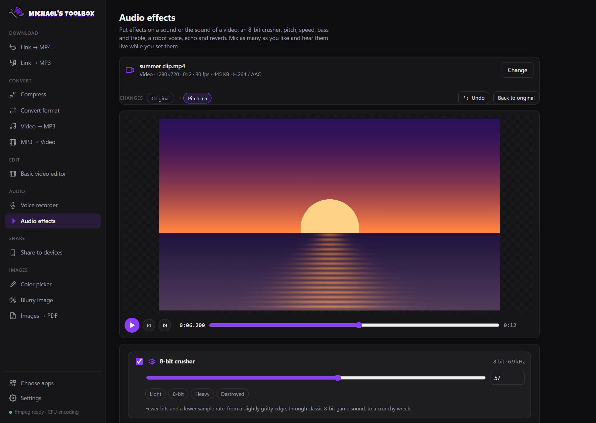
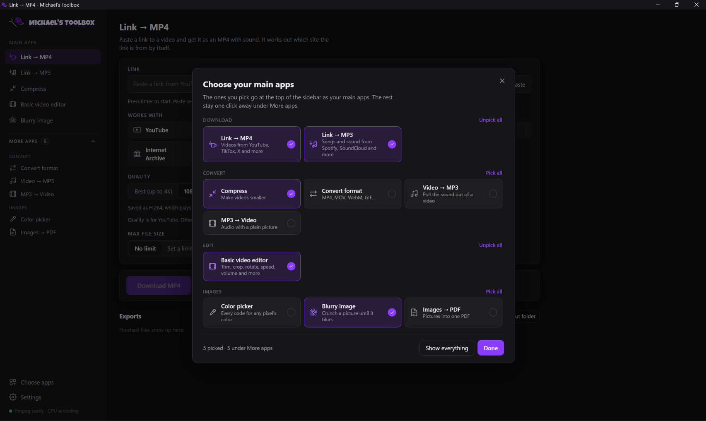

# Michael's Toolbox

**A free, all-in-one media app for Windows and Mac.** Download videos and music from the web, edit videos, convert and compress files, and work with pictures, all in one simple window. Everything runs on your own computer, with nothing uploaded anywhere.



## Download

**[Get the latest version →](https://github.com/michaelellisonaz/michaels-toolbox/releases/latest)**

- **Windows 10/11:** open **PowerShell** (Start menu, type *PowerShell*) and paste:
  ```powershell
  irm https://github.com/michaelellisonaz/michaels-toolbox/releases/latest/download/install.ps1 | iex
  ```
  It downloads the latest installer, checks it, and opens it; everything the toolbox needs comes included.
  Or download **MichaelsToolbox-Installer.exe** from the release and run it (if Windows says it protected your PC, click **More info → Run anyway**).
- **Mac:** open Terminal (Cmd+Space, type *Terminal*) and paste:
  ```
  curl -fsSL https://github.com/michaelellisonaz/michaels-toolbox/releases/latest/download/install.sh | bash
  ```
  No password or Homebrew needed. When it says *All set!*, open Michael's Toolbox from Applications.

Once installed, it **updates itself** (you can turn that off in Settings).

## What it does

### Download
- **Link → MP4:** paste a link and get the video. Works with **YouTube** (up to 4K), **TikTok** (usually without the watermark), **Instagram**, **X/Twitter**, **Odysee** and the **Internet Archive**. Optional max file size (e.g. 10 MB for Discord).
- **Link → MP3:** get the sound with title, artist and cover art filled in. Also works with **YouTube Music** (songs, albums, playlists), **Spotify** and **Apple Music** songs, albums and playlists, and **SoundCloud** tracks and sets.
- Paste several links at once to download them side by side; the site is detected automatically.

### Edit
- **Basic video editor:** trim, crop, rotate & flip, resize, change speed, change volume (fades, per-section levels, or no limit at all), reverse and glitch. Apply changes one at a time, undo any of them, and export once at the quality or file size you want.

### Convert
- **Compress:** make videos smaller by quality level or to an exact file size.
- **Convert format:** MP4, MKV, MOV, WebM, AVI or GIF (often instantly, with no quality loss).
- **Video → MP3** and **MP3 → Video**.

### Images
- **Color picker:** zoom into any picture and get a pixel's exact color as HEX, RGB, HSL, CMYK, Lab, OKLCH, Roblox Color3 and more, each with a copy button.
- **Blurry image:** crunch a picture into a deliberately low-quality, blurry version.
- **Images → PDF:** combine pictures into one PDF.

### Make it yours
- Choose which apps sit at the top of the sidebar; the rest stay one click away.
- Save videos, audio, images and PDFs to different folders, and name files your way (e.g. *1video, 2video, 3video…*, numbering remembered between sessions).
- Uses your NVIDIA graphics card (or the Mac's hardware encoder) for faster exports when available.



## Good to know
- Downloads only work for public content. Please respect creators' rights and each site's terms.
- Spotify and Apple Music audio is copy-protected, so each song is matched and downloaded from YouTube Music instead.
